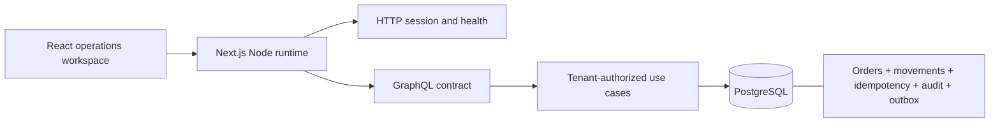

# Commerce Operations

A synthetic operations application demonstrating consistent stock reservations under concurrency and retries. This is a new personal engineering demonstration with AI assistance, not employer code or retrospective proof of company results.

## Quick path

The first increment lets an operator sign in, inspect stock, reserve units and reload the durable order. A viewer can inspect but cannot mutate. Two synthetic organizations have isolated data.

- [Evidence index across the portfolio](docs/evidence.md)
- [Observed verification and limitations](docs/verification.md)
- [Atomic reservation decision](docs/adr/001-atomic-reservation.md)
- Demo: local instructions below. No public deployment.

The initial database experiment sends 100 concurrent reservations for one unit against stock 10 and requires exactly 10 commits. Other tests cover duplicate keys, conflicting payloads, organization boundaries, historical prices and a failure injected after the stock decrement. Raw run data is emitted under `.tmp/reports/`; published snapshots are in `docs/reports/` when available.

## Local setup

Node.js 24, npm and Git are required. The Windows development host also verified Node 25; CI uses 24. Exact package versions are locked.

```sh
npm ci
node --import tsx scripts/local-db.ts
```

Keep that terminal running. This optional development runner starts **real PostgreSQL 18.4** on loopback port 55440. Its embedded-postgres packaging is prerelease, pinned for reproducibility; it is not an in-memory mock or production deployment dependency. Data is kept in ignored `.tmp/postgres`. Stop with Ctrl+C before reinstalling dependencies on Windows to release DLL locks. The known synthetic local password is only for this isolated development database.

In a second terminal:

```sh
node --import tsx scripts/run-local.ts --import tsx scripts/migrate.ts
node --import tsx scripts/run-local.ts --import tsx scripts/seed.ts
node --import tsx scripts/run-local.ts node_modules/next/dist/bin/next dev --hostname 127.0.0.1 --port 3100
```

Open **http://127.0.0.1:3100**. Accounts: `operator@aurora.test`, `viewer@aurora.test`, `operator@cedro.test`. Local helper password: `Synthetic-Test-Password`. Seed is repeatable and does not reset stock, credentials or existing orders.

Alternatively run `docker compose up -d db` with a local `POSTGRES_PASSWORD`, then export `DATABASE_URL` and `SEED_PASSWORD` and run `npm run db:migrate`, `npm run db:seed`, `npm run dev`. Compose binds only loopback; do not remove named volumes to restart. Container execution status is separate in verification.

## Verification

Start a separate disposable database:

```sh
node --import tsx scripts/local-db.ts --test
```

In another terminal:

```sh
npm run format:check
npm run lint
npm run typecheck
npm test
node --import tsx scripts/run-local.ts --test --import tsx --test tests/integration/reservations.test.ts
npm run build
npx playwright install chromium
npm run test:e2e
npm audit --omit=dev
npm audit --audit-level=low
```

Tests require a database name ending in `_test` and truncate only that dedicated database. E2E follows integration so fixtures exist. CI supplies its own disposable PostgreSQL service via `DATABASE_URL`. Never point tests at valuable data. Both production and development dependency audits must pass without exceptions; see [security](docs/security.md).

## Architecture and contracts



The initial modular monolith runs the Node GraphQL adapter inside Next route handlers. Domain input/policy, use cases and SQL transaction boundaries are separate modules. A later worker is a separate process, not a new service boundary. PostgreSQL is the source of truth. No Redis correctness dependency exists in the first slice.

- GraphQL schema: `src/server/graphql.ts`; `ReserveInput` includes variant ID, integer quantity 1–100 and caller-generated idempotency key (8–128 characters). Organization and actor come from the session.
- Errors: `UNAUTHENTICATED`, `FORBIDDEN`, `INVALID_INPUT`, `STOCK_UNAVAILABLE`, `IDEMPOTENCY_CONFLICT`. Missing/cross-tenant stock uses the same error to avoid disclosure.
- Orders use keyset pagination, maximum 50, deterministic timestamp/ID ordering. Aggregate versions start at one. Outbox records carry event ID, organization, aggregate ID/version, type and schema version 1.
- Prices are integer cents snapshotted at reservation. Currency is BRL in this demonstration.
- Migrations are append-only and transactionally versioned under an advisory lock.

## Implemented versus planned

Implemented: confirmation/cancellation with optimistic versions, database-clock expiration command, HMAC-authenticated durable payment inbox, duplicate/late-event handling, operational exceptions, reservation vertical slice, one variant line per order, one warehouse represented by available balance, two organizations, operator/viewer sessions, audit/movement/outbox persistence, SQL invariants, responsive UI, local tests and CI configuration.

Planned: customer management, full product/variant editing, multi-line orders, payment simulator, reconciliation, Redis/BullMQ recovery, operational failure dashboard, backup/restore, comparative benchmark, AWS/Terraform/OIDC, Workbench integration. Outbox recording is not delivery. Run `node --import tsx scripts/run-local.ts --import tsx scripts/expire.ts` to expire due reservations. Continuous scheduling is pending. Configure a local `PAYMENT_WEBHOOK_SECRET` of at least 32 characters for `/api/payments/webhook`; see [lifecycle contract](docs/adr/002-order-lifecycle.md).

[Program dependencies](docs/program.md) · [Interface rationale](docs/design.md) · [Security boundaries](docs/security.md)
