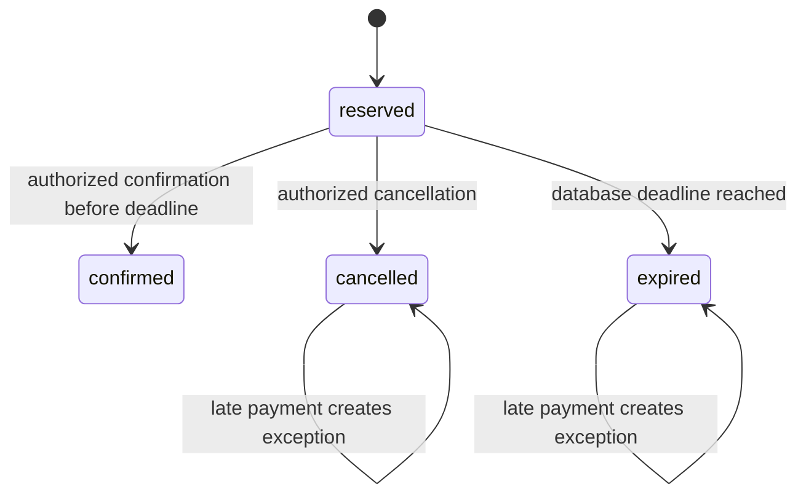

# ADR 002: Serialize terminal decisions and preserve late-payment exceptions

Order changes lock the order row, validate the expected version, then use the database clock after acquiring the lock. A confirmation after the reservation deadline is rejected. Cancellation and expiration release stock and record a movement/outbox/audit in the same transaction. Repeated expiry is a no-op; competing operator decisions accept only one version.

Payment notifications are authenticated with HMAC-SHA256 over timestamp and exact body bytes, with a five-minute tolerance. A durable inbox binds event ID to payload hash. Order locking precedes payment access on every path to avoid inconsistent lock ordering. Provider versions only move forward; contradictory terminal outcomes create a visible exception instead of overwriting the last accepted result.

A success arriving after the deadline atomically expires a still-reserved order and records `payment_after_release`. A success arriving after cancellation/expiry also records that exception. The order is never resurrected and released stock is never consumed again. Resolution/refunds remain manual and are not silently simulated.

Tradeoffs: freshness tolerance requires synchronized clocks; retries after that window must be re-signed with the same event ID. Provider version semantics are part of the synthetic contract, not assumed for arbitrary real providers. The initial expiration command is manually scheduled; durable queue scheduling and external reconciliation are a later increment.

The manual operator confirmation is a synthetic operational action, not evidence of a real payment. Only the trusted provider path can submit payment outcomes. Tests cover competing terminal transitions, duplicate/reordered events, invalid/freshness signatures, tenant/role rejection and late payment after expiry.

