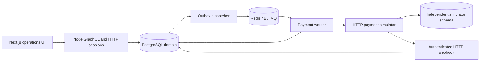
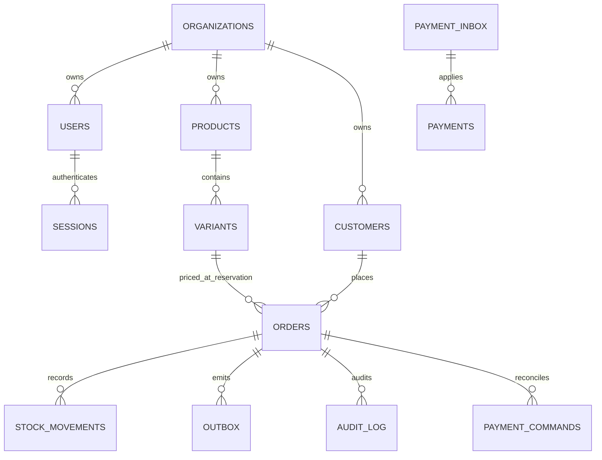
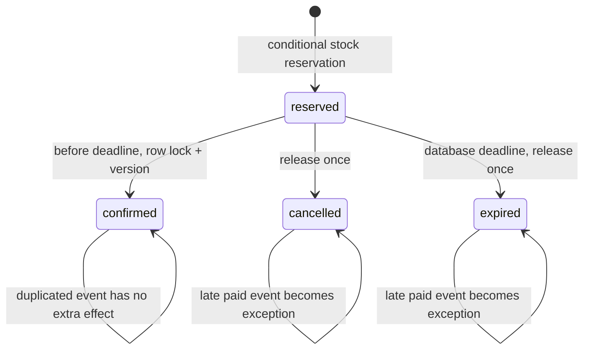
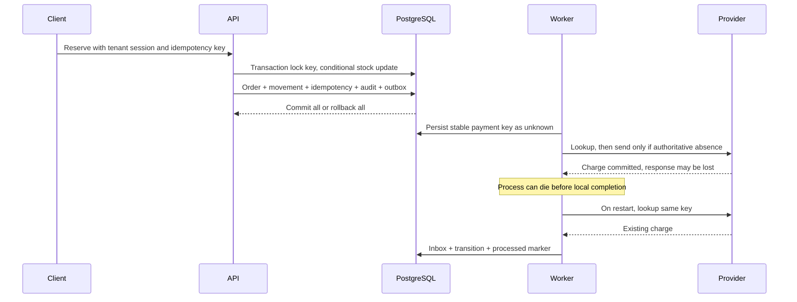

# Architecture maps

This modular monolith keeps PostgreSQL authoritative. Redis schedules work; it is
not the inventory or delivery ledger. Read [ADRs](adr/001-atomic-reservation.md),
[lifecycle decisions](adr/002-order-lifecycle.md) and [delivery decisions](adr/003-durable-delivery.md)
for alternatives, consequences and failure assumptions.

The simulator shares the PostgreSQL host for a reproducible demonstration; the
worker uses HTTP, not simulator tables. Public deployment and host isolation are
not claimed.

Tenant-scoped foreign keys prevent cross-organization references. Orders retain
historical prices and one variant line; this is not a multi-line cart or accounting
ledger. The migration files are the authoritative schema.

Queue loss is recovered by redispatching pending outbox rows. Retries do not infer
failure from a timeout: uncertain provider results require lookup. Signed webhook
versions cannot regress terminal state. See the [evidence matrix](evidence.md) for
the actual concurrency, crash, queue-loss and restore experiments and their limits.
